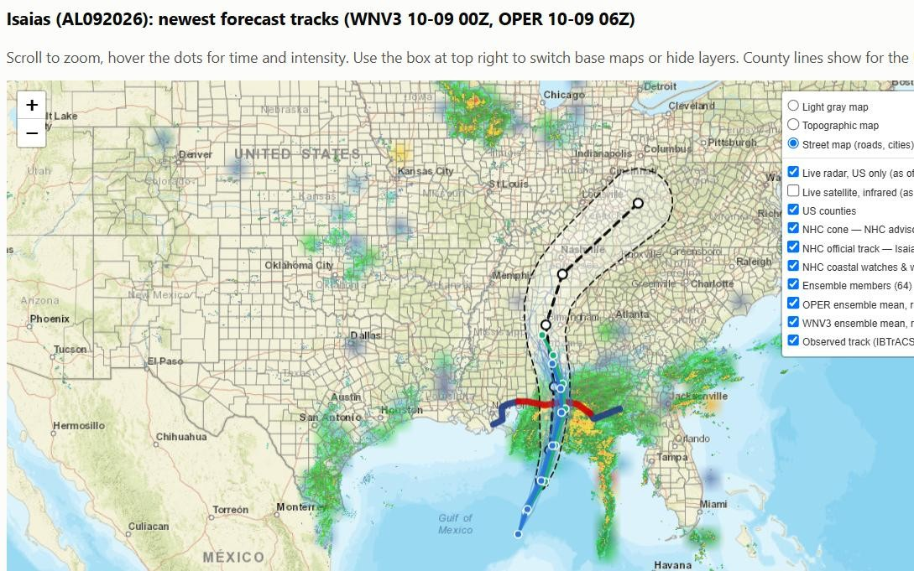

# WeatherNext Explorer

A free, local storm viewer for **Google DeepMind's WeatherNext 3** AI hurricane forecasts. It shows all 64 forecast
tracks for any active tropical storm, alongside the official National Hurricane Center cone and warnings,
live radar, and satellite.



> **Not an official forecast.** WeatherNext data is experimental research output from Google DeepMind. For
> decisions, follow the [National Hurricane Center](https://www.nhc.noaa.gov/) and your local officials.

## What you get

For any active storm, worldwide:

- **Current conditions panel** from the latest NHC advisory: category, wind, pressure, movement, distance
  from landmarks, NHC headlines, watches and warnings in effect, and a link to the full advisory.

- **Interactive map:** zoom down to counties and cities, and hover any point for time, wind and pressure.
  - all **64 WeatherNext 3 forecast tracks** and their average
  - the average of DeepMind's older operational cyclone model, for comparison
  - **NHC official** cone, track, and coastal hurricane/tropical-storm watches and warnings (Atlantic and Pacific storms NHC covers)
  - **live NEXRAD radar** (US) and **infrared satellite** (global)
  - **measured wind** at airports and NOAA buoys (sustained and gusts, color-coded, with a faulty-sensor check)
  - **NHC wind field:** how far 39/58/74+ mph winds reach now and over the forecast, plus NHC's earliest
    arrival times for tropical-storm-force winds
  - **your location:** enter a ZIP for a ★ on the map. Hover it to see how far the storm is, where and when
    each model's average track passes closest, and how many of the 64 forecasts bring the center within 50/100 mi
  - the observed track so far (NHC best track, updated each advisory; NOAA IBTrACS outside NHC's area)
- **How the forecasts did:** a map and scoreboard comparing the WeatherNext 3, operational-model and NHC
  forecasts made 1–5 days ago with where the storm actually went, in miles off and wind error.
- **Wind-speed chart:** all 64 intensity forecasts against NHC's official intensity forecast.
- **Accuracy charts:** how far off earlier runs were, by forecast length, once the storm has a track history.
- **Refresh everything button:** pulls the newest runs, advisory and radar with one click.
- **Share button:** sends a snapshot of the report through your device's share menu (email, text,
  WhatsApp, Nearby Share). The recipient just opens the file in a browser, with nothing to install. The shared
  copy is kept free of anything email virus scanners object to, so Gmail accepts it as an attachment.
- **Local forecast for your ZIP:** 16-day outlook from the 64-member WeatherNext 2 ensemble (via Open-Meteo):
  temperature, wind and rain ranges, daily cards, and the chance of rain each day.
- **15-day Gulf tropical outlook:** the chance that a tropical storm forms in the Gulf of America or NW Caribbean,
  by day, from all 64 WeatherNext 2 forecasts, with a map of where the forecast storms form and go next to
  NHC's official 7-day outlook areas.
- **Winter outlook for your ZIP:** NOAA's official 3-month outlooks at your location, the current El Niño /
  La Niña status, and the 51-member ECMWF seasonal forecast month by month (temperature and rain vs normal, and the
  share of forecasts warmer or wetter), with collapsible explainers on how seasonal outlooks work.
- Built-in explainers: what WeatherNext 3 is, how DeepMind's AI forecasting works, and how to read the map.

No accounts or API keys are needed. Every data source is free and public.

## Quick start

**You need [Python 3.10 or newer](https://www.python.org/downloads/).** On Windows, tick *"Add python.exe to PATH"*
during the install.

1. Download this repo: green **Code** button → **Download ZIP**, then unzip it. Or clone it:
   ```
   git clone https://github.com/supernole1/weathernext-explorer.git
   ```
2. Start the viewer:
   - **Windows:** double-click **`storm_report.bat`**
   - **Mac/Linux:** in a terminal, run `sh storm_viewer.sh` from the project folder

   The first run sets everything up automatically, which takes about a minute.
3. It lists the active storms. Type a storm ID (e.g. `AL092026`) and the report opens in your browser.
   Type `M` for a map of all storms, `F` for your local forecast, `G` for the Gulf tropical outlook, `W` for your winter outlook, or `Q` to quit.

   You can open a second window (double-click again) to keep a storm and your local forecast up side by side.

**Keep the black window / terminal open while you view reports.** It runs a small local helper on
`http://127.0.0.1:8913` that powers the Refresh button. Nothing is exposed outside your computer.

Storm IDs are basin + number + year: `AL` Atlantic, `EP` East Pacific, `CP` Central Pacific, `WP` West Pacific,
`IO` North Indian, `SH` Southern Hemisphere.

## How fresh is the data?

- **WeatherNext forecasts** start every 6 hours (00/06/12/18 UTC) and show up on Weather Lab about **6–7 hours
  later**. Like traditional models, they wait for a snapshot of current conditions before they can run.
- **NHC advisories** come every 6 hours, with intermediate updates between them when watches or warnings are up.
- **Radar** updates about every 5 minutes, and **satellite** every 10–30 minutes.

Press **Refresh everything** to pick up whatever is newest.

## Data sources

| Source | What it provides | Code |
|---|---|---|
| [Google DeepMind Weather Lab](https://deepmind.google.com/science/weatherlab) | WeatherNext cyclone tracks and intensity, ensemble mean and all members, 2024 to now | `wnx/weatherlab.py` |
| [NHC CurrentStorms.json](https://www.nhc.noaa.gov/CurrentStorms.json) + public advisories | Current conditions, official cone, track, intensity forecast, watches and warnings | `wnx/nhc.py` |
| [NHC best track (ATCF b-deck)](https://ftp.nhc.noaa.gov/atcf/btk/) | Observed track, updated with each advisory | `wnx/observed.py` |
| [NHC forecast aids (ATCF a-deck)](https://ftp.nhc.noaa.gov/atcf/aid_public/) | Past NHC official forecasts, for the "How the forecasts did" comparison | `wnx/nhc.py`, `wnx/history.py` |
| [NOAA IBTrACS](https://www.ncei.noaa.gov/products/international-best-track-archive) | Observed tracks outside NHC's area (runs about a day behind) | `wnx/ibtracs.py` |
| [Iowa Environmental Mesonet](https://mesonet.agron.iastate.edu/) | Live US NEXRAD radar mosaic; airport (ASOS) wind observations | `wnx/maps.py`, `wnx/windobs.py` |
| [NOAA NDBC](https://www.ndbc.noaa.gov/) | Buoy and coastal-station wind, pressure and waves | `wnx/windobs.py` |
| [Zippopotam.us](https://zippopotam.us/) | ZIP code → map location for the ★ (looked up once, then saved in your browser) | `wnx/static/my_location.js` |
| [NOAA nowCOAST](https://nowcoast.noaa.gov/) | Live global infrared satellite | `wnx/maps.py` |
| [Esri](https://www.esri.com/) | Street, topographic and light-gray base maps | `wnx/maps.py` |
| [Open-Meteo](https://open-meteo.com/en/docs/google-weathernext-api) | Local forecast page, Gulf tropical outlook and point forecasts from the WeatherNext 2 ensemble | `wnx/forecast.py`, `wnx/gulf.py`, `wnx/openmeteo.py` |
| [Open-Meteo seasonal API](https://open-meteo.com/en/docs/seasonal-forecast-api) | ECMWF SEAS5 seasonal forecast, 51 members, ~7 months | `wnx/seasonal.py` |
| [NOAA Climate Prediction Center](https://www.cpc.ncep.noaa.gov/) | Official 3-month outlooks and El Niño / La Niña status | `wnx/seasonal.py` |
| [NHC Tropical Weather Outlook](https://www.nhc.noaa.gov/gtwo.php?basin=atlc) | Official 2- and 7-day formation chances and outlined areas | `wnx/gulf.py` |

Weather Lab model codes: `WNV3` = WeatherNext 3 (64 members), `OPER` = WeatherNext Cyclones operational model
(50 members), `FNV3P2`/`FNV3P1` = WeatherNext 2 cyclone versions, `FNV3_LARGE_ENSEMBLE` = 1000 members.

**Data licensing:** WeatherNext data about times more than 48 hours ago is
[CC BY 4.0](https://creativecommons.org/licenses/by/4.0/). Fresher data is covered by DeepMind's
[experimental data terms of use](https://storage.googleapis.com/weathernext-public/terms-of-use.pdf). Each copy
of this tool downloads data directly from the sources above, so by running it you're using the data under those
terms. No forecast data is stored in this repository. NOAA data is public domain.

## Command-line scripts

The viewer wraps these scripts, which you can also run directly. On Windows, use `run.bat` in place of `python`.
They write HTML to `outputs/` and cache downloads in `data/`.

```
# Every cyclone in the latest WeatherNext 3 run: table + global map
run.bat scripts\active_storms.py

# One storm, newest runs (+ previous 2 days for comparison)
run.bat scripts\storm_report.py AL092026 --latest

# A past storm over a fixed window, e.g. Hurricane Melissa 2025
run.bat scripts\storm_report.py AL132025 --start 2025-10-21 --end 2025-10-29 --spaghetti 2025-10-25T06

# Winter (seasonal) outlook for a US ZIP code
run.bat scripts\winter_outlook.py 32578

# 15-day tropical outlook for the Gulf of America and NW Caribbean
run.bat scripts\gulf_outlook.py

# Local 16-day forecast page for a US ZIP code (WeatherNext 2 ensemble)
run.bat scripts\my_forecast.py 32578

# 64-member point forecast for any location (WeatherNext 2 via Open-Meteo), e.g. Tampa wind in knots
run.bat scripts\point_forecast.py 27.95 -82.46 --var wind_speed_10m
```

### Sample result: Hurricane Melissa (AL132025)

Average track error across all runs from Oct 21–29, 2025, compared with the observed track:

| Forecast length | OPER | WNV3 |
|---|---|---|
| 24 h | 29 km | 25 km |
| 48 h | 46 km | 40 km |
| 72 h | 69 km | 63 km |
| 96 h | 105 km | 95 km |
| 120 h | 203 km | 155 km |

## Full WeatherNext 3 gridded data (optional)

The complete hourly WeatherNext 3 fields (wind, rain, pressure and more, ~10 km grid, 15 days) are on Google
Cloud (BigQuery, Earth Engine, Cloud Storage) for approved users. You can
[request access](https://developers.google.com/weathernext/guides/access-forecast), which is free and takes about
5–7 business days. `wnx/cloud.py` has a starter BigQuery query. The storm viewer doesn't need this access.

## Ideas / contributions welcome

- Score a whole season of storms, not just one, against NHC's official forecasts
- Landfall probability: the share of the 64 members that cross a given stretch of coast
- Wind swaths from the forecast 34/50/64-kt wind radii
- Wind and rain along the storm path from the full gridded data

## License

Code: [MIT](LICENSE). Data belongs to its respective providers under the terms above. This project is not
affiliated with or endorsed by Google, DeepMind, NOAA or NHC.
